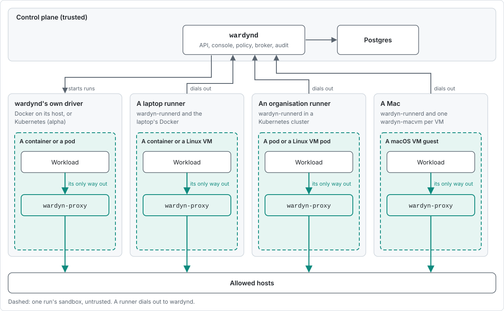
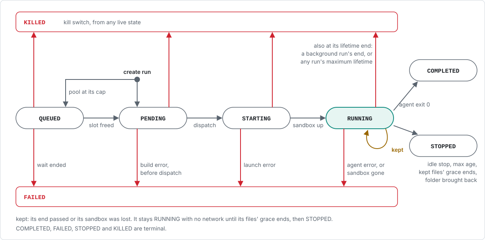
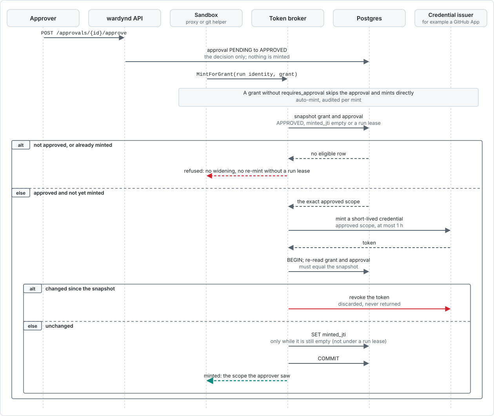

# Wardyn architecture

> [!NOTE]
> Wardyn governs workload run-identity and tokens. "Wardyn" is a working name that may change before a 1.0 ([TRADEMARKS.md](TRADEMARKS.md)). Module path `github.com/cjohnstoniv/wardyn` (personal namespace for now).

**Thesis:** the open-source governed-sandbox control plane for any workload — identity, controls, and audit are the product; the sandbox is a pluggable commodity. Coding agents (Claude Code, Codex CLI, and successors) are the flagship use, so most of what follows is framed around them. Apache-2.0 everything; CNCF Sandbox is the governance target.

> [!NOTE]
> **Status markers.** Controls below are tagged **[shipped]** / **[experimental]** / **[planned]**, matching [`threatmodel/THREAT-MODEL.md`](threatmodel/THREAT-MODEL.md); an untagged item is shipped. What each planned tag covers is in [`ROADMAP.md`](ROADMAP.md).

## Components

| Binary | Role |
|---|---|
| `wardynd` | Control plane: REST API, embedded web UI (served by the same process from a built `ui/dist` — `WARDYN_UI_DIR` — not compiled in via `go:embed`), policy engine, approval FSM, token broker, audit ingest. Postgres is the ONLY required dependency. |
| `wardyn-runner` *(dev-only)* | Standalone data-plane harness for manual and conformance testing. No Dockerfile, Makefile target, script or CI job builds it; the shipped drivers are libraries, see [below](#wardyn-runner-role). |
| `wardyn-runnerd` | A registered runner (0.9): dials out to the organisation and runs the runs it places, in containers on a laptop's Docker or in a Kubernetes cluster, or in a Linux or macOS VM; see [below](#wardyn-runnerd-runner-substrates). |
| `wardyn-proxy` | Per-workspace L2 egress sidecar: default-deny domain allowlist, method rules, first-use approval, decision logs, proxy-side credential injection; see [below](#wardyn-proxy-role). |
| `wardyn-rec` | Per-workspace PTY session recorder (execs `asciinema`; GPL subprocess, never linked). |
| `wardyn-tetragon-ingest` | Host-scoped eBPF/Tetragon ground-truth ingest sidecar: tails Tetragon's JSON export, correlates each `kernel.*` event to a run via the `wardyn.run-id` container label, and POSTs to `POST /api/v1/internal/groundtruth`. Opt-in (`groundtruth` profile). |
| `wardyn-git-helper` | In-sandbox git credential helper: brokers a short-lived, repo-scoped token from the control plane and writes it to **stdout only** (never disk or env). |
| `wardyn-scan` | In-sandbox workspace scanner: clone-and-scan a source and upload raw `ScanFacts` (profile derivation is server-side). |
| `wardyn-toolgate` | In-sandbox stdio MCP relay, built into the agent images: **cooperative, not a boundary**, so an agent that never calls it is not gated; see [below](#wardyn-toolgate-role). |
| `wardyn-aws-sso` | In-sandbox uploader for the containerized `aws sso login` capture; see [below](#wardyn-aws-sso-role). |
| `wardyn-guest-agent` | Inside a Linux VM sandbox: how `wardyn-runnerd` reaches the guest (harness launch, terminals, exec, files, folder shares). No network listener. |
| `wardyn-macvm` | Per-VM helper behind macOS VM sandboxes; also builds the Mac's base image. |
| `wardyn-vmnet` | A desktop VM's network relay: hands each connection to the run's `wardyn-proxy` and drops the rest. |
| `wardyn-signin` | The desktop image's sign-in helper: the person signs in to websites in their own browser while the agent is stopped. |
| `wardyn` | CLI (`wardyn --help` lists every group); see [below](#wardyn-role). |

The layers of the code, and the interface each extension implements, are mapped in [docs/EXTENDING.md](docs/EXTENDING.md).

<picture><source media="(prefers-color-scheme: dark)" srcset="docs/img/run-placement-dark.svg"></picture>

- The trusted control plane places each run in an untrusted sandbox whose only path out is its own `wardyn-proxy`.
- `wardynd`'s own driver places runs on Docker on its host, or on Kubernetes (alpha). A registered runner dials out to `wardynd` and places runs on a laptop's Docker, in a Kubernetes cluster or on a Mac ([runner substrates](#wardyn-runnerd-runner-substrates)).
- Decision logs flow back into the append-only audit log — drawn in [The three audit streams](threatmodel/THREAT-MODEL.md#the-three-audit-streams-mechanically).
- Masked session recordings are optional and kept in their own store, with their own retention.
- The console itself (`wardynd`'s embedded UI) is served under a single CSP (`securityHeaders`, [`internal/api/security_headers.go`](internal/api/security_headers.go)).
- Its `media-src` allowlists `github.com` and the redirect target a GitHub Release asset download resolves to, for one consumer. That is the Getting Started demo-episode player, which streams an episode only on an explicit click from the tag-pinned manifest ([`ui/src/app/lib/demo-videos.ts`](ui/src/app/lib/demo-videos.ts)). `WARDYN_DEMO_VIDEO_BASE_URL` (an air-gapped mirror) replaces both hosts with its own origin.
- Three further relaxations in that same policy are deliberate, and are named rather than summarised away:
  - `connect-src 'self'` plus this deployment's own `ws://` and `wss://` host and, with the UI gateway on, its bind URL (`cspConnectSrc`),
  - `script-src 'self' 'wasm-unsafe-eval'` (the recording replay player's WASM VT core; WASM compilation only, never JS `eval`)
  - and `font-src 'self' data:`.
- The threat model prices all of them against the admin token's at-rest posture; [Console auth token storage](threatmodel/THREAT-MODEL.md#console-auth-token-storage) quotes the served header in full.

### `wardyn-runner`: role

- The driver that ships is the **library** `internal/runner/docker`, compiled into `wardynd` (blank import, `-tags docker`) **[shipped]**;
  - the `k8s/` driver (`internal/runner/k8s`, `-tags k8s`) is **[shipped — alpha/experimental]**, conformance-gated on **both** the Docker and Kubernetes targets (see the "Parity rule" below),
  - but not yet at Docker parity (`local_dir` mounts, BYOI/devcontainer builds, a per-pod PIDs limit, and a ground-truth correlator are the open gaps — see [ROADMAP.md](ROADMAP.md)).

### `wardyn-runnerd`: runner substrates

- A runner dials out to the organisation and runs what it places there. The organisation stays the only scheduler, ceiling resolver, credential broker and audit writer.
- Its runs are placed `local`, and what they report is recorded `runner_asserted`.
- A runner's trust class (`personal`, `managed_device`, `org_cluster`) is written by a security operator, never the runner, and picks each credential class's delivery mode.

| Substrate | Who owns it | What it runs on | Install |
|---|---|---|---|
| Docker laptop runner (0.9) | A person, who claims it with their own session | The laptop's Docker, with the same sandbox, proxy sidecar and run network as a Docker run | `wardyn-runnerd setup` ([`deploy/runner/install.sh`](deploy/runner/install.sh)) |
| Kubernetes organisation runner (0.9.3) | The organisation; a security operator claims it | A dedicated runs namespace, or several each dedicated to it, through the `internal/runner/k8s` driver, beside runnerd's own namespace | The `deploy/helm/wardyn-runnerd` chart |
| Linux VM runner (0.10) | The operator of a Linux runner host | A Linux guest under QEMU/KVM, in the run's container on Docker or its pod under the `CC3` RuntimeClass on Kubernetes | `WARDYN_RUNNER_LINUX_VM=1` ([Linux VM sandboxes](docs/operations/linux-vm-sandboxes.md)) |
| macOS VM runner (0.10) | Whoever runs a company-managed Mac | A macOS guest under Apple's Virtualization framework, run by one `wardyn-macvm` helper per VM and cloned from a base image the Mac prepares | `WARDYN_RUNNER_MACOS_VM=1` on the Mac, `WARDYN_MACOS_VMS=1` in the organisation ([macOS VM sandboxes](docs/operations/macos-vms.md)) |

- **Machine kind.** A run's machine is a container (the default), a Linux VM (`linux_vm`) or a macOS VM (`macos_vm`), per [`internal/types/machine.go`](internal/types/machine.go). A runner offers a VM kind only when its operator turns it on and its start-up checks pass.
- **Laptop runner.** The developer is root on the host, so every control binds the agent, not the developer. The proxy reaches the organisation through runnerd's relay, with TLS ending at wardynd.
- **Organisation runner.** Outbound-only. runnerd's NetworkPolicy admits only its runs' proxy pods, and agent pods reach only their proxy.
  - Boot needs an enforced NetworkPolicy canary, every RBAC verb it uses, and kubelets at 1.31 or later on its architecture's schedulable nodes.
  - Each proxy denies in-cluster names and addresses, and lapses for good if runnerd stops renewing it.
- **Resident credentials (0.9.3).** A delivery policy may send four classes `runner_resident`: `env_secret`, `file_secret`, `ssh_key` and `git_pat_helper`.
  - The organisation hands each value to the run's runner before the create, under a delivery lease. The runner keeps it in the OS keystore, or a Secret on an organisation runner, and erases it at run end.
  - Erasure is best effort on a host whose owner is root.
- Boundaries B12 to B15 and residuals #69–#77, #89 and #90 in [`threatmodel/THREAT-MODEL.md`](threatmodel/THREAT-MODEL.md) state what each substrate does not protect.

### `wardyn-proxy`: role

- Per-workspace L2 egress sidecar: default-deny domain allowlist, method rules, first-use approval, decision logs, proxy-side credential injection.
- Opt-in per-run TLS interception (`intercept_tls`) of operator-listed MITM-eligible hosts (LLM endpoints, artifact registries) with outbound content inspection (`internal/contentscan`; per-proxy kill-switch `WARDYN_LLM_SCAN`) — claims-contract in [THREAT-MODEL §5.1a](threatmodel/THREAT-MODEL.md#51a-llm-egress-content-inspection--the-honest-claims-contract).
- Same binary on both targets.

### `wardyn-toolgate`: role

- In-sandbox stdio MCP relay, built into the agent images: exposes one tool (`approve`), wired as claude's `--permission-prompt-tool` on a run dispatched with `tool_approvals=hold`.
- Each tool call is raised through the proxy's brokered `POST /wardyn/v1/approvals` and blocks until decided; `DENIED`/`EXPIRED` fail closed.
- Operator-authored `tool_rules` are resolved PROXY-SIDE first (`decideByToolRules`), so an `allow`/`deny` answers without waking anyone.
- **Cooperative, not a boundary** — an agent that never calls it is not gated; see [`threatmodel/THREAT-MODEL.md`](threatmodel/THREAT-MODEL.md) B3.

### `wardyn-aws-sso`: role

- In-sandbox uploader for the containerized `aws sso login` capture: brokers the resulting SSO token cache back to the control plane over `PUT /wardyn/v1/sso-token/{runID}`.
- Built into the AWS-SSO agent image; the login run itself is a throwaway box that is never recorded.

### `wardyn`: role

- CLI: `wardyn run` (create/list/get/grants/recording/kill/logs/attach/ssh),
  - `wardyn source` (list/create/scan/delete — the shared source library),
  - `wardyn workspace` (create/list/get/delete/scan),
  - `wardyn approval` (list/get/approve/deny),
  - `wardyn audit`,
  - `wardyn policy` (list/get/default/set/delete/render — one upsert verb),
  - `wardyn secret` (set/list/delete),
  - `wardyn record`,
  - `wardyn session` (revoke/list),
  - `wardyn site-config` (get/set),
  - `wardyn support-bundle`,
  - `wardyn setup status|detect-proxy|proxy-relay|wall|vault`,
  - and more groups: `wardyn --help` is the full list.

### Feature surfaces on top of the core loop (all shipped)

- **Workspace onboarding** — a workspace is a COMPOSITION of one or more
  sources (local directories, repos, ephemeral scratch) plus a base image.
  - Clone-and-scan each source (`wardyn-scan` → `internal/workspacescan`;
    secret/service/egress needs are derived server-side), then set the
    requirements contract: what the workspace carries into every run (Required)
    versus what a run may enable (Optional).
  - Endpoints under
    `/api/v1/workspaces/`.
- **Record Mode.** Run a task open once, then synthesize a least-privilege policy from its captured audit trail (`internal/recordmode`, `POST /api/v1/runs/{id}/profile/synthesize`) and re-run it confined, by reference.
  - The synthesized *allowlist* is derived from PROXY-observed egress only: exact hosts that were actually allowed, never wildcarded, never a denied or pending host.
  - So it can only ever subset what the observed run already reached; genuine least-privilege *discovery* still needs the open record route.
  - Kernel ground-truth (exec, connect, sensitive write) has no policy field. It is surfaced as review warnings, never as silent policy.
  - **KNOWN GAP**: that kernel evidence comes from the opt-in eBPF/Tetragon sensor, which is blind inside CC3/Kata guests, and `Synthesize` does not flag its own blindness. A profile proposal for a CC3 run reads identically to a fully-observed one.
  - The record-results path computes that signal (`RecordTaskResult.kernel_sensor_blind`); the `/profile` proposal does not carry it.
  - Treat a CC3 proposal's silence on execs and writes as "not observed", not "did not happen".
- **Bring Your Own Image (BYOI)** — a run may name an arbitrary base image;
  - the control plane wraps it with the runner tools via `internal/envbuild`
    (opt-in, `WARDYN_ENVBUILD`) and gates launch on an in-sandbox
    `agent-run --selftest`, fail-closed ([`internal/api/runs_dispatch.go`](internal/api/runs_dispatch.go)).
  - Operator docs:
    [`deploy/images/README.md`](deploy/images/README.md), "Bring your own image".
- **Model-provider sign-in** — each person signs in to a `bedrock_sso` or
  `anthropic_subscription` model provider through an interactive login
  sandbox; the capture is stored age-encrypted in their own namespace and
  injected proxy-side ([`internal/api/provider_signin.go`](internal/api/provider_signin.go),
  `POST /api/v1/model-providers/{id}/sign-in`).
- **CI mode (BYOA)** — headless one-shot launches from pipelines:
  - `wardyn run
    --wait` maps the run outcome to the CLI exit code (the real task exit code
    rides the `run.complete` audit event),
  - `--image` exposes the BYOI wrap,
  - and `task_mode: "exec"` runs the task as a plain shell command instead of
    the agent harness (same governance, no agent/LLM; the branch lives in
    [`deploy/images/common/agent-run-lib.sh`](deploy/images/common/agent-run-lib.sh)).
  - [`scripts/ci-run.sh`](scripts/ci-run.sh) composes it:
    fresh compose stack → preflight → run → artifacts → teardown.
  - Docs:
    [`docs/CI.md`](docs/CI.md).

## The four nouns (`internal/types`)

- `AgentRun`, `RunPolicy`, `CredentialGrant` (eligibility), `ApprovalRequest`.
- On Kubernetes these surface as CRDs; on Docker they are the same Postgres-backed objects.
- One vocabulary everywhere.

- An `AgentRun` moves through these states ([`internal/types/types.go`](internal/types/types.go);
  - transitions
    are issued from [`internal/api/runs_dispatch.go`](internal/api/runs_dispatch.go) for the launch edges and
    [`internal/api/runs_lifecycle.go`](internal/api/runs_lifecycle.go) for the terminal ones,
  - all funnelled through the
    one compare-and-swap there — `casRunState` → `UpdateRunStateIf`, which from `QUEUED` is `LeaveRunQueue` —
  - so a kill can
    never resurrect a finished run):

<picture><source media="(prefers-color-scheme: dark)" srcset="docs/img/run-states-dark.svg"></picture>

- A run is created `PENDING`, or `QUEUED` when its runner pool is at its cap, where it holds nothing. A freed slot moves it to `PENDING`; an ended wait ends it `FAILED`.
- Dispatch moves `PENDING` to `STARTING`, and the sandbox coming up moves it to `RUNNING`. A build error before dispatch, a launch error, an agent error or a gone sandbox ends it `FAILED`; an agent exit 0 ends it `COMPLETED`.
- A kill switch ends any live state `KILLED`. So does a running run's lifetime end: a background run's end, or any run's maximum lifetime.
- A run whose end passed, or whose agent container exited or lost the control plane past its token's life, is kept.
  - That needs a substrate that can keep a sandbox (Docker can; Kubernetes cannot) and a positive ended-run grace.
  - A kept run stays `RUNNING` with no network until its files' grace ends, then `STOPPED`.
  - Any other run is `STOPPED` and torn down at once ([Run lifetime](docs/operations/run-lifetime.md)).
- An idle stop, `WARDYN_RUN_MAX_AGE` and a computer folder brought back to its own computer also end a run `STOPPED`.
- `COMPLETED`, `FAILED`, `STOPPED`, and `KILLED` are terminal.
- `WAITING_FOR_CONFIRMATION` and `ARCHIVED` exist in the state enum as reserved
  forward-compatibility values; no transition produces them today.

## Authorization kernel (`internal/authz`)

- `internal/authz` (pure Go, no HTTP, no store) is the one **`Decision`** every authorization door in `wardynd` answers with: route tier, run and workspace ownership, a capability grant, a governance ceiling, an approval.
- It also holds the one closed **registry** of the reasons an `authz.denied` audit row may carry.
- **`Decision`** ([`internal/authz/authz.go`](internal/authz/authz.go)) is schema `authz/v1`. Its fields:
  - an `Effect`: `allow`, `deny`, `hidden` (the 404 twin, so a refusal is never an existence oracle) or `unprocessable`;
  - the HTTP `Status` it maps to, a `Reason`, and a `Target` (the request field, route, or resource refused);
  - `Obligations` (e.g. an inline-policy entry dropped rather than refused) and a `Trace`.
  - Every field is data, no funcs, so a `Decision` round-trips through JSON unchanged.
- **The registry** ([`internal/authz/registry.go`](internal/authz/registry.go)) is the audit contract a SIEM rule is written against: `Reason -> {Effect, Audit, Sentence}` for every reason that may appear on an `authz.denied` row.
  - It is **append-only from the 0.8.0 tag**: a removal or rename after that is a major version.
  - The "Every denial that isn't a 404" table in [`docs/operations/denials.md`](docs/operations/denials.md) is the source of record for the reasons, and [`docs/AUDIT-ACTIONS.md`](docs/AUDIT-ACTIONS.md)'s `authz.denied` row points back to it. `TestAuthzDeniedReasonsAreDocumented` checks both against the registry.
- **`(*Server).refuse`** ([`internal/api/refusal.go`](internal/api/refusal.go)) is the one emitter. It looks up the registry row for a `Decision`'s reason and writes the HTTP status and sentence.
  - When the registry says the reason is audited, it also writes the `authz.denied` row through `authz.Datum`.
  - Every row carries the same shape, including the `user_view` marker and, for a request that came through a device channel, `device_channel`.
  - An unregistered reason fails closed: 500 in production, a panic in this package's own tests (`strictRefusals` in [`internal/api/refusal_test.go`](internal/api/refusal_test.go)). The only way to ship a new reason is to register it.

Guardrail tests that keep the kernel from regressing

- **Guardrails** ([`internal/api/authz_kernel_guardrails_test.go`](internal/api/authz_kernel_guardrails_test.go),
  `authz_kernel_nonescape_test.go`, `refusal_test.go`, `authz_test.go`,
  `preflight_launch_gate_parity_test.go`, `preflight_launch_decisions_test.go`,
  `capabilities_filter_test.go`) keep the kernel from regressing:
  - `TestNoAdHocAuthz` — no code outside `refuse`/`recordRefusal` writes an
    `authz.denied` row, a registered reason, or a stamped-role comparison by
    hand.
    - The `authz.denied` literal is checked in every non-test file under
      `cmd/` and `internal/` (outside `internal/authz`); the reason literals and
      role comparisons only in `internal/api`'s top-level non-test files
      (`parseAPISources`, `refusal_test.go`).
    - `pkg/`, `test/` and `examples/`
      are not scanned.
  - `TestEveryRegisteredReasonIsEmitted` / `TestAuthzDeniedReasonsAreDocumented`
    — the registry, the emit sites and the two docs agree, both ways.
  - `TestAuthzMatrix` (route tier, chi.Walk-enumerated, with runtime
    `ownerTier` probes) and `TestAuthzMatrixHandlersReachAuthz` (every
    `classOwner` route's handler statically references its entity's ownership
    check — run, workspace, approval — somewhere in its call graph).
    - The
      static check is a necessary condition, not a per-path proof:
      - it catches a
        check dropped outright, not a branch that skips it, and tier strictness
        (owner-or-admin vs. owner-or-super-admin) stays with the `ownerTier`
        probes.
    - Its exception map may only shrink (asserted by length).
  - `TestPreflightMirrorsLaunchGates` — a gate added to launch is either
    reproduced by preflight or named in an exception map with why; that map
    may only shrink (asserted by length).
    - `TestPreflightDecisionsEqualLaunch`
      is its behavioural half: both doors answer the same requests over one
      store, and their refusals (the `authz.denied` rows, status and body) and
      inline-policy drops must match.
  - `TestCapResolverNonescapeTable` / `TestCapabilityResolutionIsMonotone` —
    the capability resolver (`capBatch.decide`, [`internal/api/capabilities.go`](internal/api/capabilities.go))
    is exhaustively checked kind x tier x grant-state x store against a
    seven-step oracle,
    - and (property-tested) is monotone:
    - adding an ALLOW
      grant never turns an ALLOW into a DENY, adding a DENY never turns a DENY
      into an ALLOW.
  - `TestKernelDoorsAreDeclared` / `TestKernelNonescape` /
    `TestKernelNonescapeDevice` —
    - every function that asks the resolver for a
      decision is declared with the kinds it asks about (a new door, or a door
      asking about another kind, fails until the table is updated),
    - and the
      launch door is driven through the real router for each kind it gates x
      admin, security admin, user and an admin in the user view x every grant
      state,
    - against the same seven-step oracle.
    - A device context is checked at
      the resolver: never the exempt operator, only an everyone-allow lists it.
  - `TestCapFilterEqualsAllowedPerID` — the list half (`capFilter`) keeps
    exactly the ids the door would allow, restricted values included;
    - the
      console's New Run agent picker is pinned end to end against a real user
      session ([`ui/e2e/available-to.spec.ts`](ui/e2e/available-to.spec.ts), "the person's New Run picker").
  - `TestConsoleCapabilityKindsMatchGoTable` — the console's capability-kind
    mirror ([`ui/src/app/lib/permissions-copy.ts`](ui/src/app/lib/permissions-copy.ts)) cannot silently drift from
    the Go kind table.

- The kernel does **not** yet expose `Tier`/`Owns`/`Allowed`/`Ceiling` as named methods on a `Kernel` type. Today's doors (`isOperator`, `ownsRunOrAdmin`, `capAllowed`, `effectiveCeiling`, …) stand in for them, and the guardrails are written against those names.
- A laptop joins as a client-mode runner and the org remains the only decider ([docs/design/0.9/PLAN.md](docs/design/0.9/PLAN.md)). `Decision` stays wire-serializable; `Principal.Origin` is zero until the org sets it.

## Security invariants

1. **Keep credentials out of the sandbox wherever Wardyn can broker them; name and bound every kind that enters.**
   - Late binding via the broker; third-party API credentials are injected
     proxy-side (`egress.InjectionRule`), so as a rule no secret sits in env,
     disk, or args —
     - model-provider keys, `api_key` grants and a Claude sign-in's token never
       enter the sandbox (env inside shows only a placeholder);
     - a static key the operator delivers as an `env_secret` or `file_secret`
       does enter,
     - and minted credentials expire on their issuer's clock: Wardyn revokes
       only Azure DevOps `minted_pat`, and otherwise stops further mints.
   - These residuals break
     that rule deliberately — each bounded and disclosed rather than hidden.
   - The authoritative, complete list is [`threatmodel/THREAT-MODEL.md` §5.1a](threatmodel/THREAT-MODEL.md#51a-llm-egress-content-inspection--the-honest-claims-contract). It is deliberately **not** copied here: a shorter copy printed beside the word "complete" is a drift surface.
   - How each kind of credential reaches a run, and what the sandbox can read afterwards, is in [`docs/CREDENTIALS.md`](docs/CREDENTIALS.md).
   - The
     shapes it covers are grant-delivered credentials with no injection seam, the
     AWS role credentials a person's own `bedrock_sso` run derives in-process,
     - and the
       container-login runs whose whole purpose is to obtain a
       credential that does not exist yet.
   - Secret values are masked on the audit/recording/decision-log streams by
     `internal/secretmask` (verbatim-match; the encoded/transformed-exfil residual
     is documented).
   - Masking is structurally **control-plane-side**, on the
     brokered upload path only:
     - the optional
       `WARDYN_RECORDING_MOUNT`/`wardyn-rec -out-dir` shared-mount recording fallback
       bypasses the control plane and therefore delivers **UNMASKED** casts —
     - do not
       use it where recordings are viewer-exposed (see
       [`threatmodel/THREAT-MODEL.md`](threatmodel/THREAT-MODEL.md#41-output-masking-and-the-paths-it-does-not-cover) and [`docs/RECORDING-ROOT-READ.md`](docs/RECORDING-ROOT-READ.md)).
   - *(Scope note: the proxy sets a brokered GitHub App token, and a `git_pat` while
     the PAT broker is on, on the outbound request; neither reaches `git`.*
     - *Only with `WARDYN_GIT_PAT_BROKER=off` does a PAT reach `git`, through the
       helper's stdout.*
     - *The helper's per-run caller-auth gate value is a separate, low-value
       authentication nonce, deliberately a 0400 agent-owned file + descendant-scoped
       env, that gates — and is not — the credential;*
     - *see `cmd/wardyn-git-helper`.)*
2. **Approval mints the credential.**
   - `CredentialGrant` = eligible.
   - For a grant with `requires_approval: true`, the mint needs a snapshot showing
     `approvals.state = 'APPROVED'` for this run+scope; the re-verifying commit
     writes `approvals.minted_jti`, or the credential is discarded.
   - A grant without `requires_approval` (the default) is auto-mintable: it creates
     no approval row, is re-mintable by design, is capped at 1h TTL and audited
     per mint.
   - A `git_pat` approval with `decision_scope=run` is a per-run lease that covers
     re-mints for the run's life.
   - Tested invariant: minted scope ==
     the scope the approver saw.
   - No widening, ever.
3. **L0 structural egress.**
   - On Docker a sandbox has no default route; its only path
     out is `wardyn-proxy`. On Kubernetes a canary-proven NetworkPolicy default-deny does the same.
   - `HTTP_PROXY`/`HTTPS_PROXY` are set for client
     compatibility, but security does NOT rely on them:
     - because the network has no route off the host, an agent that ignores the proxy env vars (the documented env-var
       bypass class) reaches nothing.
   - Loopback, link-local/metadata
     (169.254.169.254) and other reserved addresses are unconditionally blocked.
   - Private RFC1918/ULA/CGNAT addresses are blocked unless an admin declared the hostname under `internal_hosts`.
4. **Per-run identity with full attribution.**
   - The minted run identity token
     (`identity.Claims`) carries the full delegation chain: `sub` (human), `act`
     (agent-run SPIFFE ID), and `sponsor`.
   - `AuditEvent`, however, has a single
     `Actor` field (`actor_type` + one string — human sub, agent SPIFFE ID, or
     component name);
     - today's mint/egress audit events record only `act` (the
       agent's SPIFFE ID) there, not a separate `sub`/`sponsor` pair per event.
   - No impersonation; delegation is recorded as delegation: a registered portal
     acting for a signed-in person is never the actor — the person is, and every
     row the request writes names the portal as `data.via` (#1142).
   - A service identity is its own actor, not a person: its rows carry `actor_type` `service`,
     and every row it writes names its sponsor in `data.sponsor` (#1508).
   - Enforcement points live at the proxy/gateway/broker — never inside the
     agent loop.
5. **Fail closed; never overclaim.**
   - Drivers declare `Capabilities()`;
     policy refuses what a substrate cannot enforce —
     - it refuses to *start* rather than
       silently downgrading the tier you asked for,
     - and the tier actually enforced is a queryable fact of the run record
     - (Confinement Classes CC1 runc / CC2 gVisor, preferred wherever `runsc` is
       registered / CC3 Kata **[experimental]** — surfaced in the README, UI, and CLI
       by their friendly names **Fence / Wall / Vault**).
   - Embedded identity provider
     refuses `cloud_sts` grants (SPIRE required).
   - Residual risks are
     published in `threatmodel/`, not hidden.
6. **Audit is append-only and free.**
   - Every mint/revoke/approval/policy
     change/egress decision is an event.
   - The Postgres trigger blocks
     UPDATE/DELETE/TRUNCATE, so a written event can never be altered or erased by
     the application — append-only is enforced at the datastore, not by app convention.
   - The one removal is the drop of a whole partition older than the retention
     window, which is off by default and leaves a chained event and an anchor ([OPERATIONS.md](docs/OPERATIONS.md#audit-retention-the-attested-partition-drop)).
   - NOTE:
     control-plane audit WRITES (identity mint/revoke, approval decide, broker
     revoke, a refused or failed broker mint) are still best-effort — the call
     site is fire-and-forget (`_ = rec.Record(...)`), so a write can still fail.
   - A successful broker mint is the exception.
     Its `credential.mint` row rides the mint's own transaction with the
     single-use burn, and the mint is refused if that row cannot be written
     ([`internal/broker/mint_commit.go`](internal/broker/mint_commit.go)).
   - The shared recorder chain is `maskingRecorder → spoolingRecorder → auditRec`, and every audit writer (API, broker, identity, approvals, sweeper) shares it.
     - When the primary Postgres write fails, the (already-masked) event is spooled to a durable local append-only JSONL fallback (`WARDYN_AUDIT_SPOOL`) instead of being lost, for every writer, not just the API server.
   - This is durability via a local fallback, not a transactional guarantee: a write and its spool append can both fail (logged when that happens).
   - The ground-truth ingest path is a stronger, already fail-closed guarantee ([the three audit streams](threatmodel/THREAT-MODEL.md#the-three-audit-streams-mechanically)).
   - SIEM export is never paywalled.

### Invariant 2, mechanically

<picture><source media="(prefers-color-scheme: dark)" srcset="docs/img/credential-mint-dark.svg"></picture>

- This describes a grant with `requires_approval: true`, on the once-only path.
- An explicit `git_pat` run lease is the exception: after the first mint, a re-mint under the same scope skips the `minted_jti` write, and `credential.mint` is marked `lease: true` ([member runs](docs/operations/member-runs.md)).
- Approval records the human decision only; the credential is minted **later**,
  when the run's own proxy or git-helper requests it (`MintForGrant`) —
  - returned only from
    the Postgres transaction that re-verifies the `APPROVED` approval for that
    exact run and grant and claims `minted_jti`,
  - so the minted scope always equals
    the approved scope and, off a run lease, a grant never mints twice.
  - A newly issued GitHub token lasts at most an hour. A stored `git_pat` is returned as stored: its one-hour expiry bounds how long Wardyn offers it, not the PAT's own validity.
  - A GitHub token the commit refuses is never returned, and its revocation at GitHub is attempted, best effort.
- `api_key` grants are then
  injected proxy-side (the agent never sees them); a GitHub App token and a `git_pat`
  (broker on) are set at the proxy, and a PAT reaches `git` through
  `wardyn-git-helper` stdout only with `WARDYN_GIT_PAT_BROKER=off`.

> [!IMPORTANT]
> **This sequence is credential-mint specific — it does not describe an `egress_domain` decision.**

- An egress approval funnels through the same
  `decide()` chokepoint ([`internal/api/approvals.go`](internal/api/approvals.go)) and the same append-only
  audit discipline, but it never mints anything: no broker call, no
  transaction, no `minted_jti`.
- What it carries instead is a **scope** —
  `once` / `run` / `until` / `always` — bounding how far the decision reaches,
  from a single connection up through a permanent entry on the target
  workspace's `approved_egress`/`denied_egress`.
- See
  [docs/POLICIES.md](docs/POLICIES.md) "Approval decision scopes" for the full
  semantics.

### Git egress: three credential lanes, disjoint host sets

Git has THREE credential lanes and they are not duplicates — which serves a
clone is decided by grant kind and host, and none can cover another's set:

| Grant / transport | Mechanism | Where the credential lives |
|---|---|---|
| `github_token`, granted repo, HTTPS | **proxy git broker** — `git`'s `url.<broker>.insteadOf` rewrites the remote to `http://wardyn-proxy:3128/wardyn/gh/<org>/<repo>` ([`internal/egress/proxy/git_broker.go`](internal/egress/proxy/git_broker.go)) | proxy memory only; an un-brokered GitHub URL has no route **by name**, and `WARDYN_GIT_BROKER_ENFORCE_BRANCH_NS=false` opts a proxy out of the push-branch confinement; see [below](#github_token-credential). |
| `git_pat` (GitLab, or a GitHub PAT on a forge the run is NOT brokered for), HTTPS | **proxy PAT broker** (`WARDYN_GIT_PAT_BROKER=on`, the default since 0.7) — the proxy terminates the request, mints server-side and sets Basic auth on the OUTBOUND leg; see [below](#git_pat-mechanism). | proxy memory only on the default; helper stdout → `git` under `off`, where the PAT is resident for the run ([§5.1a](threatmodel/THREAT-MODEL.md#51a-llm-egress-content-inspection--the-honest-claims-contract)); not least-privilege either way; **not available for the SAME forge as a `github_token` grant**; see [below](#git_pat-credential). |
| `ssh_key`, any host | **proxy SSH agent** — `wardyn-git-helper ssh-exec` bridges each `ssh` to it ([`internal/egress/proxy/ssh_agent.go`](internal/egress/proxy/ssh_agent.go)) | proxy memory only; **not available at all for the SAME forge as a `github_token` grant**; see [below](#ssh_key-credential). |

- **Azure DevOps is not a fourth grant kind.** It has no `git_pat` or `ssh_key` path: a shared token or key is refused on an Azure DevOps row.
  - The credential a run carries is the person's own: a PAT Wardyn creates for the run in their name (`minted_pat`), their Entra token (`bearer`) or a PAT they pasted (`own_pat`).
  - An Azure DevOps Server row is git only.
  - The control plane resolves it from the run's provider row and the proxy injects it. The sandbox never holds it.
  - Git reaches it through the proxy's own git route, `/wardyn/git/<host>/`, served by `serveADOGit` ([`internal/egress/proxy/pat_broker_entra.go`](internal/egress/proxy/pat_broker_entra.go)).
  - The request is pinned to the run's organisation (the collection's path on Server) and checked against the capability it needs.
  - A push is held to the run's branch and content rules, and the request goes out with the resolved credential.
  - [docs/AZURE-DEVOPS.md](docs/AZURE-DEVOPS.md) has the modes.
- The GitHub broker is structurally github.com-only and App-token-only: it has no host parameter and no username plumbing, and authenticates as `x-access-token`. A GitLab PAT cannot traverse it.
- `ssh_key` cannot be proxy-injected at all: git's SSH transport has no credential-helper seam, so the proxy acts as its SSH agent.
- `git_pat` CAN be proxy-injected, but only through its OWN broker (the row above).
  - On the default `WARDYN_GIT_PAT_BROKER=on`, `agent-run`'s rewrite removes the tunnel rather than injecting into it: the proxy terminates the request and re-originates it with Basic auth.
  - With the broker off, git-over-HTTPS to that host is the same opaque CONNECT tunnel `ssh_key` faces ([`internal/types/types.go`](internal/types/types.go), `GrantGitPAT`/`GrantSSHKey`).
- Deleting either path drops an SCM.
- The helper does not serve the GitHub App path on a **brokered** run, one the broker serves at least one repo for (`WARDYN_GIT_BROKER_REPOS` non-empty).
  - It refuses every GitHub host there rather than print an installation token to stdout inside the sandbox. That token could be pushed straight to `github.com:443`, an opaque tunnel around the broker's receive-pack ref check. The proxy's mint route refuses the same grant id, so the env var is not a way back to it.
  - "Has a grant" and "is brokered" are not the same set. A `github_token` grant covering no repo has no `/wardyn/gh/` route and no injected GitHub deny, so the helper is still its credential path and mints unchanged.
  - A GitHub host with no App grant at all still falls through to a `git_pat` grant.
- A policy may not declare a `github_token` grant and an `ssh_key` **or** `git_pat` grant for the same forge: either would give a brokered run a second push path the receive-pack parser cannot read. See [docs/POLICIES.md](docs/POLICIES.md) "The `ssh_key` and `git_pat` lanes are closed too".

### `github_token`: credential

- proxy memory only; dispatch subtracts + denies the broker-managed GitHub hosts for any run with git grants (`confineGitBrokerEgress`), so an un-brokered GitHub URL has no route **by name** —
  - these are name-keyed denies, so under `allow_all_egress` a raw-IP CONNECT is a different key and is not bound by them
  - (bounded in practice because no GitHub credential reaches a brokered sandbox).
- The repo is the unit of trust.
- Pushes are confined to `refs/heads/wardyn/<run-id>/*` by default — `agent-run` checks the clone out onto `wardyn/<run-id>/work`; `WARDYN_GIT_BROKER_ENFORCE_BRANCH_NS=false` opts a proxy out

### `git_pat`: mechanism

- **proxy PAT broker** (`WARDYN_GIT_PAT_BROKER=on`, the default since 0.7) —
  - `agent-run` rewrites the granted hosts to `url.<broker>/git/<host>/.insteadOf`,
  - so the proxy terminates the request, mints server-side and sets Basic auth on the OUTBOUND leg ([`internal/egress/proxy/pat_broker.go`](internal/egress/proxy/pat_broker.go));
  - the grant ids are withheld from the sandbox env.
- `WARDYN_GIT_PAT_BROKER=off` restores the pre-0.7 in-sandbox **`wardyn-git-helper`** lane, which brokers on `git`'s `get` and writes to stdout

### `git_pat`: credential

- proxy memory only on the default; helper stdout → `git` under `off`, where the PAT is resident for the run ([§5.1a](threatmodel/THREAT-MODEL.md#51a-llm-egress-content-inspection--the-honest-claims-contract)).
- Non-resident is not least-privilege either way — a PAT carries whatever scope the operator issued it with, so the broker's allowlist is per-HOST.
- **Not available for the SAME forge as a `github_token` grant** — refused at policy write (`validateGrantLaneExclusivity`), withheld from the sandbox at dispatch for anything already stored (`dropBrokeredGrants`), and refused at mint

### `ssh_key`: credential

- proxy memory only, behind its SSH agent, closed after the clone.
- **Not available at all for the SAME forge as a `github_token` grant** — refused at policy write (`validateGrantLaneExclusivity`),
  - and for anything already stored, withheld from the sandbox at dispatch (`dropBrokeredGrants`)
  - while `confineGitBrokerEgress` denies that forge's SSH endpoint too

## Layered egress (per-target status — see each layer's own tag)

- L0 structural (no route off the host) **[shipped]** → L1 default-deny, which is NetworkPolicy **[shipped, k8s target]** or nftables **[planned, docker target]**, plus Cilium toFQDNs on the blessed Helm path **[planned]**.
- Then L2 `wardyn-proxy` (L7 allowlist and injection) **[shipped]** → L3 per-tool-call approval **[partial]**.
- What each layer stops, and the residuals: [THREAT-MODEL.md](threatmodel/THREAT-MODEL.md#4-in-scope-defenses).

| Layer | Mechanism |
|---|---|
| L0 structural **[shipped]** | A run's network has no route off the host; the only off-host path is `wardyn-proxy`. On Docker it is an internal bridge, gateway mode `isolated`, IPv6 off, with no address on the host ([`run_network_shape.go`](internal/runner/docker/run_network_shape.go)) |
| L1 default-deny **[shipped on k8s; planned on docker]** | Per-run `NetworkPolicy` on k8s, proven by a boot-time egress canary; nftables on docker is not built ([below](#l1-default-deny-mechanism)). It adds depth atop the L2 metadata guard, which does not wait on it |
| L2 wardyn-proxy **[shipped]** | Domain allowlist (exact + `*.` wildcard), method rules, first-use approval, proxy-side credential injection, and an unconditional loopback, link-local and metadata guard that also covers DNS rebinding ([below](#l2-wardyn-proxy-mechanism)) |
| L3 MCP gateway **[partial]** | Per-tool-call approval and logging **[shipped]** (`tool_rules`, `wardyn-toolgate`); interception of tool-call egress **[planned]** |

- Before Docker Engine 28 a run is refused unless `WARDYN_ALLOW_HOST_REACHABLE_RUN_NETWORK=1` ([run networks](docs/OPERATIONS.md#docker-host-run-networks)).

### L1 default-deny: mechanism

- **k8s [shipped]**: per-run `NetworkPolicy` (blocking `169.254.169.254`), proven live by a boot-time egress canary that refuses to construct the substrate on a CNI that doesn't enforce it
  - (`WARDYN_K8S_ALLOW_UNENFORCED_NETPOL=1` is the logged, opt-in downgrade — see [ROADMAP.md](ROADMAP.md)).
- **docker [planned]**: nftables, not built (the driver's capabilities report `NetworkPolicy: false`, [`internal/runner/docker/hardening.go`](internal/runner/docker/hardening.go)); Cilium `toFQDNs` also planned, either target

### L2 wardyn-proxy: mechanism

- Domain allowlist (exact + `*.` wildcard);
- method rules;
- first-use approval ([`internal/types/policy.go`](internal/types/policy.go): `always_deny` / `deny_with_review` / `wait_for_review`, which holds the *same* in-flight connection open for a live operator decision and resumes it on approve) —
- each decision itself carries a scope, `once` / `run` / `until` / `always` ([docs/POLICIES.md](docs/POLICIES.md)), bounding how far it reaches from one connection up to a permanent workspace-wide allow/deny;
- proxy-side credential injection
- The order of these checks, and each refusal's `rule_source`: [threat model §4.2](threatmodel/THREAT-MODEL.md#42-the-unconditional-ip-guard-and-its-two-admin-authored-exceptions).

## Deployment surface (anti-sprawl constraint)

- Exactly TWO stacks: `deploy/compose` (config-validated in CI; exercised
  end-to-end by the nightly full-stack e2e) and ONE blessed Helm chart
  `deploy/helm/wardyn` (`helm lint` + `helm template` render-checked in CI on both
  the default values and `ci/all-on-values.yaml`, plus its refusals).
- No
  "your arbitrary K8s".
- The `deploy/helm/wardyn-runnerd` chart is not a third stack: it installs an organisation runner into a compute cluster, which dials out to an organisation running one of the two.
- The **desktop tier** (`deploy/desktop`, [docs/DESKTOP.md](docs/DESKTOP.md)) is a
  third packaged SHAPE and not a third stack — its `docker-compose.yaml` is an
  `include:` of [`deploy/compose/docker-compose.yaml`](deploy/compose/docker-compose.yaml) plus a ports trim (`docker-compose.ports.yaml`), and nothing else.
- What the envelope adds around that one stack is a managed-laptop lifecycle:
  a root `install.sh`,
  - a supervisor (`com.wardyn.daemon.plist` on macOS, a
    `wardyn.service` + `wardyn.timer` pair on Linux) that re-asserts the stack at boot
    and on each tick rather than assuming it,
  - log rotation, and an MDM-owned read-only
    `/etc/wardyn` carrying the envelope, secrets, the policy ceiling and site-config —
  - `WARDYN_MANAGED_DIR` is how that directory reaches the containerized `wardynd`.
- Packaged by [`scripts/build-desktop-package.sh`](scripts/build-desktop-package.sh) into the MDM-distributable payload
  (a `.deb` and a tarball; `--rpm` adds the third).
- It has
  its own threat posture, because the developer is root on the laptop and the
  governance authority is not them:
  - [`threatmodel/THREAT-MODEL.md`](threatmodel/THREAT-MODEL.md)'s member-mode
    actor row and boundary B9 both cover it.

The compose stack ([`deploy/compose/docker-compose.yaml`](deploy/compose/docker-compose.yaml)):

- **Control plane** — one `wardynd` service on `:8080` (the browser opens
  `localhost:8080`; under WSL, in the Windows browser) plus `postgres`.
  - A third service starts by default: `registry`, the local devcontainer-build registry. `wardynd` declares `depends_on: registry`, so every bring-up path starts it whether or not a devcontainer is ever built.
  - It is multi-homed onto `wardyn` and `wardyn-envbuild`. The second bridge is the untrusted envbuilder BUILD container's, which is deliberately NOT a member of `wardyn`, so it can push images without becoming an in-network peer of `postgres` or wardynd's admin API.
- **Opt-in profiles** — `sso` adds Dex (`WARDYN_LOCAL_MODE` bypasses it);
  `groundtruth` adds `tetragon` → `wardyn-tetragon-ingest` → `wardynd`.
- **Build-only profile** — six entries that are images, not services:
  `proxy-image`, `agent-base`, `agent-claude-code`, `agent-codex-cli`,
  `agent-vscode`, `agent-aws-sso`.
- **Per-run sandboxes** — `wardynd` calls the Docker API to create each run its
  own internal network (agent container + `wardyn-proxy` sidecar).
  - State
    persists to the `postgres_data` volume; `wardynd` holds `recordings` and
    `audit`.

> [!IMPORTANT]
> **Deployment status:** containerized (compose) is the default; host mode is an
> escape hatch (`WARDYN_SETUP_MODE=local`).

- A **team** deployment, the compose control plane packaged and supported as a sealed, multi-user shared service, does not exist and is not scheduled (see [ROADMAP.md](ROADMAP.md)).
  - The Dex (SSO) profile and OIDC backend exist and are CI-tested, and the console's SSO sign-in lights up when OIDC is configured.
- Authorization under it is real:
  - every OIDC session carries an **admin**, **security_admin** or **member** role derived at login (`WARDYN_OIDC_ROLE_MAP` against Entra App Roles, groups or email, merged with console-managed rows; unset = everyone admin, upgrade-safe);
  - a member is scoped to their own runs and approvals with owner-or-admin gating (a foreign resource answers a byte-identical 404, no existence oracle);
  - a member's own policy is clamped to the operator's ceiling, and BYOI/devcontainer images are admin-only.
- The admin token and local mode are always admin: one shared credential carries no human to demote.
- The second admin tier, `security_admin`, holds governance authority (approvals, audit, capability grants, governance profiles, revocation) that deliberately never reaches INTO a run. `isSecurityOperator` admits it and `isOperator` does not; the two predicates sit beside each other rather than on a ladder.
- Not built: custom roles, per-resource permissions, tenant/org columns, and separation of duty WITHIN the super-admin tier. Full semantics, including the legacy `WARDYN_OIDC_OPERATOR_EMAILS` allowlist path: [docs/OPERATIONS.md "Multi-user: who can change what"](docs/OPERATIONS.md#multi-user-who-can-change-what).
- `make setup` asks **containerized vs host** (Enter = containerized). Team is not a selectable mode (`WARDYN_SETUP_MODE=team` prints a notice and exits): RBAC is a control-plane property today, not a packaged multi-tenant deployment.

## Parity rule

- The control plane contains zero target-specific code: only
  `internal/runner` subpackages and the runner binary (`cmd/wardyn-runnerd`) may import Docker or Kubernetes client
  libraries —
  - `internal/runner/docker` (`-tags docker`) and `internal/runner/k8s`
    (`-tags k8s`) each self-register into the substrate registry
    (`internal/runner/substrate`) from their own `init()`,
  - so a tagless binary
    carries neither and fails closed on either `-runner` name —
  - with one blessed
    exception: `internal/envbuild` (plus its narrow shared helper
    `internal/dockerutil`) legitimately imports the Docker client directly
    because it drives the coder/envbuilder devcontainer build as a Docker
    container (see [`docs/ENVBUILD.md`](docs/ENVBUILD.md)),
  - a distinct concern from launching the
    agent sandbox itself.
- `test/conformance` runs the full suite against **both** targets in CI, not
  just docker:
  - the `conformance` job drives the **docker** target against a
    live daemon (`WARDYN_TEST_DOCKER=1`),
  - and the `conformance-k8s` job drives
    the **k8s** target (`internal/runner/k8s`) against a real cluster —
  - kind with
    `disableDefaultCNI: true` plus a pinned Calico manifest,
  - since kind's default
    `kindnet` CNI does not enforce `NetworkPolicy` and the k8s substrate's
    boot-time egress canary refuses to construct without it.
- Neither job
  tolerates a failure.
- The `vm-conformance` job runs the VM relay suite (`test/vmconformance`, `-tags vm`) on a runner with `/dev/kvm`.
- A shared conformance case that has no k8s equivalent
  self-skips there by design rather than faking a result —
  - the k8s substrate
    claims L1 (NetworkPolicy-enforced), not L0 (structural, no route off the host),
  - so the
    L0-specific case self-skips on that target and a dedicated L1 case
    (`testAgentCannotReachAPIServer`) proves the substrate's actual claim
    instead;
  - see [docs/PLUGGABILITY.md](docs/PLUGGABILITY.md) for the full
    per-seam status.
- A feature is not done on Kubernetes until it passes conformance there, on every change.
