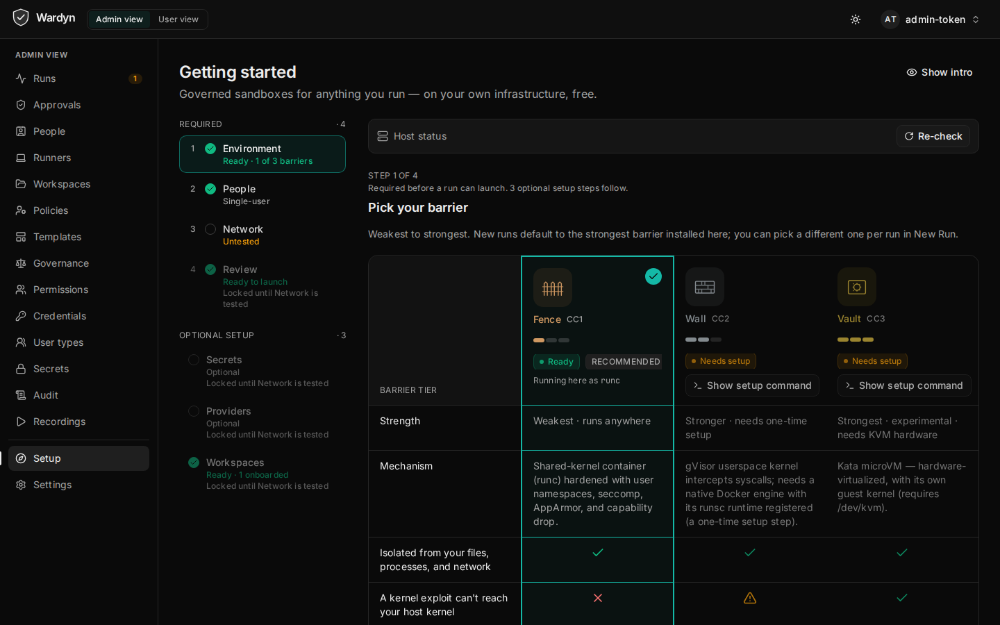
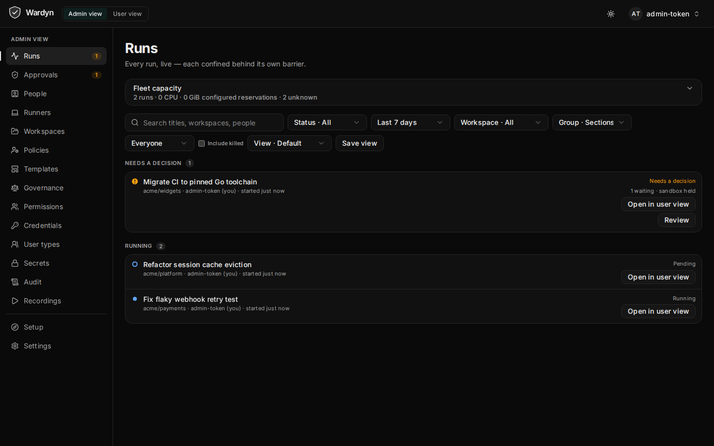

# Try Wardyn in 10 minutes

- The guided walkthrough. It picks up after the [README install](../README.md): the stack is up, the console is open at <http://localhost:8080>, and `wardyn setup status` says whether model access is set up (optional: only agent-harness runs need it).
- Easiest first: a **governance demo** (no keys), a **real Claude Code run** (bring an Anthropic API key), and **record, then replay confined** to onboard your own work.

## Before you start

- The commands run from `~/.wardyn` (or `$WARDYN_HOME`), where the one-line installer put `docker-compose.yaml` and `.env`. The installer leaves no clone, so there is no `Makefile` and no `examples/` tree.
- **The admin token.** The installer mints one and prints where it lives: `grep WARDYN_ADMIN_TOKEN ~/.wardyn/.env`. `demo-admin-token` is only the default of a stack started from a clone ([`deploy/compose/docker-compose.yaml`](../deploy/compose/docker-compose.yaml)'s `${WARDYN_ADMIN_TOKEN:-demo-admin-token}`).
- **A Claude Code image.** Level 2 and the Claude sign-in need one you supply. The installer pins `claude-code` to `agent-base`, which ships no coding agent, and Setup's image row says so. [Build one and repoint that entry](operations/build-images.md#claude-sign-in-image).
- **`--policy-file examples/policies/<name>`** needs a file you do not have. Fetch it at the release you installed. The version is the first line of `~/.wardyn/.env` (`# Generated by install.sh for Wardyn vX.Y.Z`), where the installer's own upgrade check reads it from:

  ```sh
  v=v$(sed -n '1s/^# Generated by install\.sh for Wardyn v\{0,1\}\([^ ]*[0-9a-z]\)\..*/\1/p' ~/.wardyn/.env)
  curl -fsSLO "https://raw.githubusercontent.com/cjohnstoniv/wardyn/${v}/examples/policies/sandbox.yaml"
  ```

### From a clone

After `make setup` from a clone, the make targets replace the installer's commands:

| from a clone | one-line install |
|---|---|
| `make setup` | the installer already did it; `docker compose up -d` re-ups |
| `make compose-down` | `docker compose down` |
| `make reset` | `docker compose down -v && docker compose up -d` — wipes runs, audit and recordings; leaves `.env`, and so the age key |
| `make agent-images-core` | build a Claude Code image yourself (above) |
| `make doctor`, `make test-drive` | clone-only (`scripts/up.sh doctor`, [`scripts/test-drive.sh`](../scripts/test-drive.sh)); the console's Getting-started rail runs the same capability probes |

## What the console detects

- The Getting-started rail detects this host's real capabilities
  - which confinement tiers exist (Fence = CC1 hardened runc, Wall = CC2 gVisor, Vault = CC3 Kata microVM),
  - whether an LLM path exists,
  - secret-store durability,
  - then walks the rail's steps to your first run.
- Whatever you configure has to pass a live probe before that step unlocks.
- Nothing is ambient, so a run reaches an integration only when its workspace requires it by name, and a model only through a model provider.



Config facts before you customize:

- **Policy defaults depend on how wardynd was launched.**
  - A bare hand-launched `wardynd` loads [`examples/policies/default.json`](../examples/policies/default.json) (`min_confinement_class` **CC1** as of 0.7.8, no authored `api_key` grant — an agent run reaches a model only through a configured model provider and the person's own credential for it).
  - `make setup` / [`scripts/up.sh`](../scripts/up.sh) auto-pick one:
    - containerized picks `demo.json` on a runc-only host, `default.json` when gVisor is registered, and `claude-llm.json` once a real model path is configured;
    - `demo.json` and `default.json` differ not in confinement but in allowed-domains breadth and idle auto-stop (one hour in `default.json`, off in `demo.json`);
    - host mode picks `claude-llm.json`.
  - An unspecified run defaults to the organisation's default class when it is set, offered and at or above the policy floor.
  - Otherwise it gets the STRONGEST class the host's runner actually advertises at or above the floor.
  - So with no organisation default, CC2/CC3 need no policy switch, just the runtime installed.
  - The Getting Started **Review** step warns
    - when your stored credential and the live `WARDYN_DEFAULT_POLICY` disagree,
    - and when the policy's confinement floor (an admin override above CC1, say) names a tier this host's runner can't enforce.
    - Every run on that policy would then be refused before it launches, with an opaque error on the first real attempt.
- **The server's runner limits.** A runner takes no run until it has limits.
  - The one-line installer sets none. Before the first run, pass what `wardyn runner remote propose <id> --free-disk <GB>` prints to `wardyn runner set <id>`, or use the console: Runners, the runner, **Set limits** ([runner pools](operations/runner-pools.md#a-remote-hosted-runners-limits)).
  - `make setup` sets the server's Docker runner to half of this host; on Docker Desktop it asks for free disk (or reads `WARDYN_SETUP_RUNNER_DISK_GB`).
- **Secret-store durability.** `make setup` / [`scripts/up.sh`](../scripts/up.sh) mint and persist a `WARDYN_AGE_KEY`. Only a hand-launched bare `wardynd` runs on an EPHEMERAL age key (secrets unreadable after restart); run `wardynd -gen-age-key` to mint a durable one.

## Level 1 — governance demo (no keys)

- The console's demos below run on the installer's stack. From a clone, two make targets build the images and walk the stack:

```sh
make agent-images-core   # build wardyn/agent-base:local + agent-claude-code:local + agent-codex-cli:local
make test-drive          # ARGS defaults to --up, which brings the compose stack up first
```

- `make test-drive` ([`scripts/test-drive.sh`](../scripts/test-drive.sh)) walks the table below against the running stack and prints what each step proved:
  - a governed clone and the no-default-route check, an egress deny,
  - the cloud-metadata block (a proof the table doesn't cover),
  - a first-use approval (queue → approve → retry), the brokered git-credential chain,
  - and the kill cascade with its `run.kill` audit event.
- Its one weak step is the recording: it only checks that the endpoint refuses an unauthenticated read, not that the recorder captured a live session.
- Check the **Recording** tab after a real run for that.
- `ARGS='--section 3'` runs one section, `ARGS='--keep'` leaves its runs alive to poke at.

- The UI is at http://localhost:8080. The demo stack configures no OIDC, so the SSO button is disabled and the admin token below is the way in;
  - bring up the `sso` compose profile (`docker compose -f deploy/compose/docker-compose.yaml
    --profile sso up -d dex`, then set `WARDYN_OIDC_ISSUER=http://localhost:5556` and `WARDYN_LOCAL_MODE=false` and restart `wardynd` — see [deploy/compose/README.md](../deploy/compose/README.md)) and the role split appears with two real identities already seeded in Dex:
    - sign in as `demo@wardyn.local` for **admin**, `member@wardyn.local` for an owner-scoped **member** —
    - on a **fresh** stack, [`deploy/compose/.env.example`](../deploy/compose/.env.example) already maps them that way (`WARDYN_OIDC_ROLE_MAP`);
    - an existing `.env` predating this pair keeps whatever it already had, so add the row by hand if you're on one.
- Point `WARDYN_OIDC_OPERATOR_EMAILS` at your own address instead to use your own login as admin — and set `WARDYN_OIDC_EMAIL_DOMAINS` to your own domain —
  - compose defaults it to `wardyn.local`, which denies every other address.
- The split, the approval broker and the append-only audit log all ship in the Apache-2.0 build with no paid tier.
- For the exact 403 boundary and how to give a second person their own login, see [OPERATIONS.md](OPERATIONS.md#second-user-same-host).

By hand against the same stack:

```sh
export WARDYN_URL=http://localhost:8080
export WARDYN_ADMIN_TOKEN=$(sed -n 's/^WARDYN_ADMIN_TOKEN=//p' ~/.wardyn/.env)   # from a clone: demo-admin-token
wardyn run --agent claude-code --task-mode exec --repo octocat/Hello-World --task 'ls && git log -1'
wardyn run list        # watch state
wardyn audit <id>
wardyn approval approve <approval-id> --reason "reviewed scope, looks correct"

# Or bring a sandbox up idle and drive it yourself (--interactive is mutually
# exclusive with --wait). The idle reaper still applies: sandbox.yaml stops the
# run after 900s idle — set auto_stop_after_sec <= 0 for a never-reap session.
# sandbox.yaml is the file fetched in "Before you start" (from a clone: examples/policies/sandbox.yaml).
wardyn run --agent claude-code --interactive --policy-file sandbox.yaml
wardyn attach <id>
```

- Prefer clicking?
- The demos on the User view's Getting Started page (<http://localhost:8080/setup?step=sealed-box> — `/demos` redirects there) launch throwaway sandboxes with an embedded terminal and live approvals — no repo, no workspace.
- Two sections: **Egress demos** and **Secrets demos**.
- Fifteen of the sixteen need no model at all, only the sandbox barrier itself.
  - Most of the Secrets ones additionally want a stored secret, which the Admin view's setup at `/admin/setup` walks you through adding.
  - A couple gate on a GitHub App, or nothing at all.
- The Egress group includes: **the sealed box** (`always_deny` — `curl` fails instantly with a 403), **fail then approve** (`deny_with_review` — approve, retry, it succeeds), **held at the door** (`wait_for_review` —
- `curl` *hangs* at the proxy until you approve, then the same in-flight command completes), **lines that can't be crossed** (allow-all policy, yet `169.254.169.254` and private-IP probes stay denied — no policy can grant them),
- **denied, however you spell it** (allow-all plus one `denied_domains` entry — the trailing-dot spelling of the blocked host meets the same 403, and the refusal names its reason in `X-Wardyn-Egress` headers),
- **once, or for good** (`deny_with_review` — approve with **Once** and the retry succeeds, but the *next* attempt after that raises a brand-new approval: the grant covers one connection, not the run),
- and **record a policy** (allow-all policy, then synthesize what it actually touched into a least-privilege allowlist you can save and re-run confined).
- One more egress card, **the agent in the box**, appears once you connect a model (Level 2 below).
- It runs a real Claude Code agent under the same policy primitives, its model injected proxy-side, with `api.anthropic.com` the only host it can reach.

- The **Secrets** group is eight cards covering a stored *value* rather than a destination —
  - the write-only store itself, proxy-side header injection, an approval-gated single-use mint, and then one card per credential KIND,
  - because what a credential's own protocol accepts is what decides how far out of the sandbox it can be kept:
    - an `api_key` never enters the box, a `git_pat` stays at the proxy by default (it enters only with `WARDYN_GIT_PAT_BROKER=off`), an `ssh_key` is signed for by the proxy,
    - a `github_token` is minted proxy-side and refused if the sandbox asks for it, and a `cloud_sts` grant is refused at run-create outright without a SPIRE identity provider.

<!-- Regenerated with `make screenshots` (docs.spec.ts) for 0.7.4. Freshness is
     flagged per-PR, as an advisory annotation from ci.yml's diagrams job
     (RELEASING.md "Prerequisites"), not by a release-cut step. -->


What you can verify live, even without keys:

| What | How |
|---|---|
| L0 isolation | `docker exec wardyn-agent-<id> cat /proc/net/route` → no row with an all-zero destination, i.e. no default route (the slim agent image ships no `ip` binary) |
| Egress policy | from the sandbox, curl an unlisted domain via the proxy → 403 + a pending approval in the UI |
| Approval queue | the Approvals tab; approve/deny and watch the audit trail |
| Attributed audit | Audit tab: every event carries `actor_type` human/agent/system |
| Terminal replay | Runs tab → a run → **Recording** (the recorder captures even failed agent starts) |
| Kill switch | `wardyn run kill <id>` → container gone, run token revoked (401), audit `run.kill` |
| Brokered credentials | `docker exec wardyn-agent-<id> sh -c 'printf "protocol=https\nhost=github.com\n\n" \| wardyn-git-helper get'` → raises a credential approval; approving it hits the fail-closed mint (no GitHub App configured) — the whole chain is visible in audit |

- Want a worked scenario per control?
- [`examples/workspaces/`](../examples/workspaces/) is a catalog of six small workspaces — benign, exfil attempt, metadata probe, needs-approval, github-push, long-running —
  - each with the exact task text, the `wardyn run` command, and its PASS criteria, plus a key-free `probes.sh` you can point at any RUNNING sandbox.

## Level 2 — real Claude Code run (bring your own model credential)

- On the one-line install, first see [Before you start](#before-you-start).

```sh
# 1. An admin adds an Anthropic model provider (Settings → Model providers), then
#    you connect your own key for it from Getting started (write-only; no API
#    path ever returns it). The same door over the API:
curl -sS -X PUT "$WARDYN_URL/api/v1/model-providers/anthropic/credential" \
  -H "Authorization: Bearer $WARDYN_ADMIN_TOKEN" -H 'Content-Type: application/json' \
  -d "{\"value\":\"$ANTHROPIC_API_KEY\"}"

# 2. Switch the default policy to the LLM-enabled one and restart wardynd:
WARDYN_DEFAULT_POLICY=/examples/policies/claude-llm.json docker compose \
  -f deploy/compose/docker-compose.yaml up -d wardynd

# 3. Create a real run:
wardyn run --agent claude-code --model-provider anthropic --repo octocat/Hello-World \
  --task "Read the repository and write a SUMMARY.md describing it"
```

- Before you run step 3, list the repository in the `github_token` grant's `scope.repos` in `claude-llm.json` (it ships `"repos": []`, which the broker cannot mint against), or the clone fails; see [POLICIES.md](POLICIES.md#github_token).
- What happens: the run's model provider (`--model-provider anthropic`) supplies your own credential for `api.anthropic.com`, not a policy grant;
  - the proxy resolves the key **at startup, into proxy memory only** (the sandbox never sees it — check: `docker exec
    wardyn-agent-<id> env | grep ANTHROPIC_API_KEY` prints the literal sentinel `wardyn-proxy-injected`, never your key);
  - Claude Code talks to `ANTHROPIC_BASE_URL=http://wardyn-proxy:3128/wardyn/llm/anthropic`, where the proxy injects `x-api-key` and records its model calls as `brokered:llm` decisions in the audit trail. A "Decisions dropped" row in the Audit page counts any the proxy had to drop
  - (an admin can re-point that brokered dial at an internal gateway through the provider's base URL under Settings → Model providers, with no sandbox-visible change at all).
- Watch the session live via Attach (`wardyn attach
<id>`, or the console's Live terminal) — the **Recording** tab plays back the captured cast only after the fact, it has no live view.

- For real GitHub pushes: create a GitHub App (contents+PR write), then `wardyn secret set github-app-id` and `wardyn secret set github-app-key` (PEM), restart, and approve the agent's credential request —
  - the minted installation token is 1h, repo-scoped, and permission-clamped to `contents:write` + `pull_requests:write` (a GitHub CLI grant's: to its capabilities).
- Branch-namespace confinement (`wardyn/<run-id>/*`) is recorded in the token metadata and **enforced on the brokered git path by default**: a push to any other ref is refused with 403 before minting.
- Nothing to enable — `agent-run` checks each cloned repo out onto `wardyn/<run-id>/work`, so a stock run is already inside its namespace; `WARDYN_GIT_BROKER_ENFORCE_BRANCH_NS=false` on the proxy opts out.

> [!WARNING]
> - By default the confinement binds the brokered GitHub App path only.
> - The token broker reads a `git_pat` push too, and confines it only when the `pat` scope of `WARDYN_GIT_BROKER_ENFORCE_BRANCH_NS` is on (off by default; [`docs/ENV.md`](ENV.md#wardyn_git_broker_enforce_branch_ns)).
> - With `WARDYN_GIT_PAT_BROKER=off`, a `git_pat` push is an opaque CONNECT tunnel the proxy cannot read. An `ssh_key` push is not smart-HTTP, so the proxy cannot read it on any setting.
> - The installation token is repo-scoped but not ref-scoped, so a token leaked out of the proxy is unconstrained by anything in the token, unless the repo carries a GitHub ruleset. `WARDYN_GITHUB_REQUIRE_REF_RULESET` (opt-in, off by default) gates on it.
> - How each git credential is bounded: [CREDENTIALS.md](CREDENTIALS.md), [POLICIES.md](POLICIES.md#the-ssh_key-and-git_pat-lanes-are-closed-too) and the [threat model](../threatmodel/THREAT-MODEL.md).

### Model auth: model providers

- A run's model credential comes only from its **model provider**.
  - An admin adds providers under Settings → Model providers (`PUT /api/v1/model-providers`).
  - Each person connects their OWN credential for a provider — a key, a Claude sign-in or an AWS sign-in — from Getting started.
- Wardyn never substitutes. A run whose provider cannot credential it is refused at create, naming the provider and what to fix. A run with no provider at all launches with only a warning.
- The operator-held paths (a key in the operator's secret store, the managed subscription, Bedrock boot configuration) are retired: `wardyn secret set` refuses the model-credential names, and boot refuses the old variables ([ENV.md](ENV.md) lists them).

The kinds (API key, Claude subscription, AWS Bedrock) and their rules are in [Integrations](operations/integrations.md#the-provider-kinds).

## Level 2.5 — record a session, rerun it as a governed unit

- The primary way to onboard your own work: in a workspace, **record** a named interactive session (with model access), then rerun it governed —
  - the New Run dialog's Basics step offers the workspace's recorded sessions as **profiles**;
  - picking one fast-tracks you to Review with the recording's observed egress already loaded into the allowlist.
- **Replay confined** launches a fresh CONFINED session for a recording you pick — default-deny egress, live approvals surfaced next to the attached terminal —
  - so you re-run the same steps under the tightened policy and prove the profile works before relying on it.
- An off-policy host is **held at the door**:
  - the connection parks at the proxy while an approval surfaces in the live strip next to the terminal (`wait_for_review`),
  - and approving it completes that same in-flight request — no retry needed;
  - denying it, or letting the hold deadline pass, fails it closed.
- Approving one there does more than release the connection:
  - it durably writes a required `egress:<host>` row into the workspace's own requirements contract, so a later confined replay of the same workspace does not hold on that host again — see [`docs/POLICIES.md`](POLICIES.md).

- The confined session's allowlist is **not** the approved set alone.
- It is:
  - baseline clone/registry hosts
  - ∪ the workspace profile's detected registry hosts (`EgressDomains`)
  - ∪ the operator's `ApprovedEgress`
  - ∪ every required `egress:<host>` row in the workspace's requirements contract (scan-seeded, operator-set, or just durably approved through a hold as described above)
- so it is much tighter than the open recording, but it is **not minimal**:

> [!WARNING]
> - **Residual** — a GitHub clone no longer appears in this allowlist at all.
> - It is routed through the Wardyn git-broker (repo-scoped, token minted proxy-side), so `github.com` and its bundle are **not** in the confined session's egress.
> - The residual is the reverse — the baseline is otherwise the workspace profile's detected registries ∪ `ApprovedEgress` ∪ approved requirement rows.
> - And the replay proves the steps work under that policy without proving it is the smallest one that works.
> - Content-derived `SuggestedEgress` is deliberately excluded — a build that needs a host (including an un-granted GitHub dependency) surfaces as an observed denial you can promote.

> [!NOTE]
> - It's a live re-run under the tighter policy, not a byte-for-byte replay of the captured session.
> - It is also the ONLY environment proof Wardyn offers: the old import-flow "verify" step — which executed an operator-approved command list to show the environment built — is gone.
> - Detected build commands are now documentation (AGENTS.md), because nothing verified them.

- **Workspaces from the CLI:** `wardyn workspace create|list|get|delete|scan` manages onboarded workspaces headlessly (`create` is what clears the run-create onboarding gate for `--policy-file` workspace mounts).
- The committable env-as-code a finalize emits is re-fetchable any time via `GET /api/v1/workspaces/{id}/env-as-code` (same `emitted_files` shape), and a finished session's cast downloads with `wardyn run recording <run-id> [-o file]`.

- **From the CLI:** `wardyn record task <workspace-id> <task-key>` records a single named session —
  - `task-key` is a free-form name you choose ("build & test", "agent dev loop", anything), not picked from a derived taxonomy —
  - in an OPEN (allow-all egress) sandbox, so you can learn exactly what that session actually uses.
- The session idles for `wardyn attach`; when it ends, the capture lands on the workspace, and `wardyn record synthesize <run-id>` previews the least-privilege profile (or promote the observed egress from the workspace page's recorded-session pane — **Approve N observed hosts**).

## Stop / Reset

```sh
make stop-host           # Local (host) mode: stop the background wardynd (PID in ~/.wardyn/)
make compose-down        # compose stack: stop it — KEEPS your data (runs + audit)
make reset               # start over from an empty Runs list: wipes Postgres + recordings volumes
                         # (confirms first — default No; WARDYN_FORCE_RESET=1 headless)
```

- `make reset` operates on the **compose** stack: it wipes those volumes and brings up a *containerized* wardynd.
- A live host-mode daemon would collide with it on `:8080`, so a still-running one is offered a stop first —
  - interactively, a separate y/N prompt (never lumped into the wipe's own confirmation);
  - headlessly, only if you *also* set `WARDYN_FORCE_STOP_HOST=1`
  - (`WARDYN_FORCE_RESET=1` alone confirms the volume wipe and nothing else, so it never silently kills a host-mode daemon it wasn't asked to touch).
- To reset host mode instead, `make stop-host && make setup`.
- `make doctor` is read-only — it creates and changes nothing on this host — so re-run it any time to re-check this host's capabilities.
- (Its one container is a throwaway `alpine:3.20 test -S`, run `--pull=never` to check whether your docker socket is bind-mountable, and skipped outright when that image isn't already local.)

### When it goes wrong

| Symptom | Cause | Fix |
|---|---|---|
| `compose up` fails on network labels | a dead run's sandbox pair still holds `wardyn-internal` | `docker ps -aq --filter name=wardyn- \| xargs -r docker rm -f`, then `docker network rm wardyn-internal` |
| `docker ps` shows nothing but the UI works | your shell is on a different daemon than Wardyn's scripts picked | `export DOCKER_HOST=unix:///var/run/wardyn-docker.sock` — the socket `wardyn setup wall` configures and the CLI prints (`/run/...` also works where `/var/run` is a symlink), the tier-capable native daemon they prefer over the default socket |
| Only Fence/CC1 offered | ditto — that daemon registers no `runsc`/`kata` | same; `make doctor` prints the classes it can actually see |
| Record/replay hangs forever | host mode under Docker Desktop + WSL2 NAT | use containerized mode (the default) — drop `WARDYN_SETUP_MODE=local` |
| Run fails "issue with selected model" | no model access configured, or a stale credential | connect your own credential for the run's model provider (Getting started), then `wardyn setup status` |
| Port 5432 in use | another Postgres | stop it, or set `WARDYN_PG_PORT` |

- Limits of this demo deployment (see [`threatmodel/`](../threatmodel/)):
  - single host,
  - CC1/CC2 only unless a Kata runtime is registered (CC3/Vault is experimental — needs /dev/kvm + Kata; not available on Docker Desktop),
  - wardynd holds the host Docker socket (daemon-trust tradeoff, documented in the compose file),
  - and the model-API channel is a logged-but-open data path by design.
