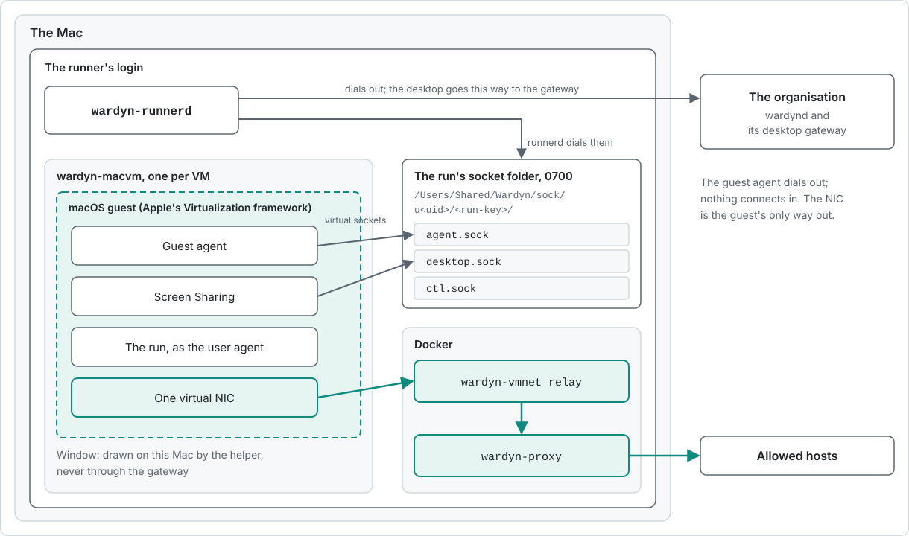

> Part of the [Operations](../OPERATIONS.md) split (task pages under `docs/operations/`).

# macOS VM sandboxes on a Mac

- A macOS VM sandbox (`machine_kind: macos_vm` on a run) is a macOS guest under Apple's Virtualization framework, started by a registered `wardyn-runnerd` on a Mac. Wardyn does not ship macOS: each Mac downloads Apple's restore image and builds its own base image once.
- It is a preview and off by default, in two places: the organisation and the Mac. The helper and guest agent are built and unit-tested, and the first runs on real Macs are still to come ([Not yet tested on a real Mac](macos-vm-troubleshooting.md#not-yet-tested-on-a-real-mac)).
- This page is for the person or admin who runs the Mac. The console's New run page offers it (choose a virtual machine, then macOS), `POST /api/v1/runs` takes it too, and `wardyn run --machine-kind macos_vm` asks for it (`--macos-base <name>` picks a base other than Standard). A Run document for `--file` cannot carry either; the flags stand beside it.
- The Linux counterpart is [Linux VM sandboxes](linux-vm-sandboxes.md).

## Where things are

| Topic | Page |
|---|---|
| Quickstart, windows, recording, limits | [macos-vm-use.md](macos-vm-use.md) |
| Watching a background run's desktop | [macos-vm-use.md](macos-vm-use.md#watching-a-background-runs-desktop) |
| Shared folders | [macos-vm-use.md](macos-vm-use.md#folders) |
| Drives | [macos-vm-use.md](macos-vm-use.md#drives) |
| Apps that use only the system trust store | [macos-vm-use.md](macos-vm-use.md#apps-that-use-only-the-system-trust-store) |
| Preparing, customising and the prep proxy | [macos-vm-base-image.md](macos-vm-base-image.md) |
| Setup by hand | [macos-vm-base-image.md](macos-vm-base-image.md#setup-by-hand) |
| Editing a base | [macos-vm-base-image.md](macos-vm-base-image.md#editing-a-base) |
| Several bases | [macos-vm-base-image.md](macos-vm-base-image.md#several-bases) |
| Apple's boot-time hosts | [macos-vm-base-image.md](macos-vm-base-image.md#apples-boot-time-hosts) |
| Disk, logins, backups, credentials, what the host can see | [macos-vm-host.md](macos-vm-host.md) |
| How many VMs a Mac offers | [macos-vm-host.md](macos-vm-host.md#how-many-vms-a-mac-offers) |
| The shared ledger | [macos-vm-host.md](macos-vm-host.md#the-shared-ledger) |
| Faults and where to look | [macos-vm-troubleshooting.md](macos-vm-troubleshooting.md) |
| What has not run on a real Mac | [macos-vm-troubleshooting.md](macos-vm-troubleshooting.md#not-yet-tested-on-a-real-mac) |

## What a run gets

<picture><source media="(prefers-color-scheme: dark)" srcset="../img/macos-vm-run-dark.svg"></picture>

| Part | What it is |
|---|---|
| The machine | A macOS guest with the CPUs and memory the run was given, never more than the runner's per-run limits. It runs as the standard user `agent` |
| The disk | A copy-on-write clone of the Mac's base image, made for the run and deleted when the run ends |
| The agent | The Wardyn guest agent in the guest serves terminals and starts the run through the launcher, `/usr/local/bin/agent-run` ([What starts in a guest](#what-starts-in-a-guest)). It dials out to the runner over a virtual socket; nothing connects in |
| The helper | The runner's login runs `wardyn-runnerd` and one `wardyn-macvm` helper per VM. The helper joins the guest's virtual sockets to `agent.sock` and `desktop.sock` in the run's socket folder, `/Users/Shared/Wardyn/sock/u<uid>/<run-key>/` ([mode `0700`](macos-vm-host.md#the-shared-ledger)), and the runner dials them there |
| Tools | Apple's Command Line Tools (git, clang, python3) and the pinned harness CLIs, installed once into the base. A Mac offers only the harnesses its base can run |
| Network | One virtual NIC, wired to the run's own network relay and proxy in Docker. The guest has no other way out |
| Proxy and connections | The proxy variables and the cap of 1,024 open connections per run are a Linux VM's ([what a run gets](linux-vm-sandboxes.md#what-a-run-gets)) |
| Desktop | The guest's own Screen Sharing, reached only through the runner and the organisation's gateway, with a Linux VM desktop's clipboard rules. Recorded while watched at Screen and actions, unmasked ([Recording](macos-vm-use.md#recording)) |
| Confinement | The VM boundary, which the runner treats as the `CC3` family. The run's recorded `confinement_class` stays the one it asked for |
| Sign-ins | Kept on the run's virtual disk, not in memory ([Credentials and sign-ins](macos-vm-host.md#credentials-and-sign-ins)) |

- Not in this release: Linux VMs on a Mac and reviving a stopped VM. Each is refused with a reason.
- A macOS VM is never paused when idle: a run under a profile with idle pause is refused (`placement_capability`, field `pause_idle_after_sec`). `interactive_start: agent` is refused too, and the terminal opens a shell.
- `ssh -L`, sftp and `wardyn attach` work against a macOS VM run. A forward to ports 5900 to 5909 is refused: open the run's window instead.
- At Screen and actions a macOS VM run's desktop is recorded while someone watches it, and Review says so. At Terminal it is not. Console and SSH terminal sessions are recorded at this run's recording level, as any run's are, and so is a task run's agent output ([Recording](macos-vm-use.md#recording)). Recording does not refuse a macOS VM run at create.
- macOS VMs need a pool where every runner offers them; a mixed pool refuses them. This matches Linux VMs.
- A Kubernetes runner refuses the kind.

## What starts in a guest

- The launcher, `/usr/local/bin/agent-run`, is the guest agent's own binary, which stage 2 installs into the base. It keeps the contract the Linux images keep, so a run's workload starts the same way on every machine.
- It runs as `agent`, after the run's files are in place: the harness's configuration, the run's repos (cloned through the run's proxy) and the starting folder.

| Run | What starts |
|---|---|
| Agent task | The run's harness on the task: Claude Code (`claude -p`) or Codex CLI (`codex exec`) |
| Command | The command, as `/bin/sh -c`, with no harness |
| Self-test | `agent-run --selftest` checks the guest can start the harness or a command, and writes nothing |
| Refused | Tasks for several agents, held tool approvals, a service, a workspace scan, and an interactive agent session. The launcher exits 64 with the reason |

- **Managed files.** The runner moves each file a run's policy manages to where macOS reads it: Claude Code's managed settings and MCP servers to `/Library/Application Support/ClaudeCode`, Codex's requirements to `/etc/codex`. Paths under `/home/agent` move to `/Users/agent`. A managed file with no macOS location stops the run's start with a reason.
- **Before the run starts.** The launcher checks each managed file is in place: root's at its mode, in a folder only root can change. A file that is not stops the run's start with a reason.

## Before you start

| Requirement | Detail |
|---|---|
| The Mac | Apple silicon, macOS 26 or later. On macOS 26 each prepare, `--new-image` too, needs [setup by hand](macos-vm-base-image.md#setup-by-hand) once per base, about 10 minutes at the Mac. macOS 27 sets the guest up unattended |
| Docker | A running engine on the Mac. The guest's network relay and proxy run in it, and the runner needs it to start ([Docker on the Mac](#docker-on-the-mac)) |
| Network | An uninspected path to `updates.cdn-apple.com`, which Apple pins: a TLS-inspecting proxy fails the image download at once, and the error prints the image URL and names `--ipsw`. The same exemption covers [stage 2](macos-vm-base-image.md#the-prep-proxy)'s opaque tunnels |
| Disk | Free space to prepare, and more to start a second VM ([Disk](macos-vm-host.md#disk)) |
| Power | On AC power to start preparing ([Preparing the base image](macos-vm-base-image.md#preparing-the-base-image)) |
| A login | Someone logged in on the Mac ([Logins, FileVault and restarts](macos-vm-host.md#logins-filevault-and-restarts)) |
| Company-managed | The Mac's trust class is `managed_device` and its posture file says `mdm_managed` ([Which Macs qualify](#which-macs-qualify)) |
| The package | `wardyn-runnerd.pkg` from this release, which installs the VM helper and the shared ledger ([Installing with a macOS package and MDM](hybrid-laptops.md#installing-with-a-macos-package-and-mdm)) |

## Turn it on

1. In the organisation, set `WARDYN_MACOS_VMS=1` ([`WARDYN_MACOS_VMS`](../ENV.md#wardyn_macos_vms)) and restart `wardynd`. With it off, create refuses the kind.
2. Install the runner package on the Mac and register the Mac as a runner ([Claiming a runner](hybrid-laptops.md#claiming-a-runner)). Set its per-run limits for a macOS guest ([How many VMs a Mac offers](macos-vm-host.md#how-many-vms-a-mac-offers)).
3. Turn the Mac's own switch on: `WARDYN_RUNNER_MACOS_VM=1` in the runner's environment, or the managed preference `MacOSVM` from your MDM, or answer yes when `wardyn-runnerd setup` asks.
4. Have a security operator mark the Mac `managed_device` ([Which Macs qualify](#which-macs-qualify)) and have your MDM attest posture: the `MDMManaged` key in the profile, or the posture file.
5. Prepare the base image: `wardyn-runnerd macos-vm prepare`, or answer yes to the setup question and let `setup` start it ([Preparing the base image](macos-vm-base-image.md#preparing-the-base-image)).
6. Check it with `wardyn-runnerd macos-vm status`. A run is placed on the Mac only when the base is ready.

- The two switches are separate gates. The organisation's decides whether a run may ask: with it off, create refuses `macos_vm`. The Mac's decides what its runner offers: with it off, the Mac offers no macOS VMs.

## Keeping the machine

A run's VM is deleted when the run ends. With `macos_vm.allow_kept_machines` on (off by default), a person can keep one on their own Mac between runs: [the commands, what stays on the disk, expiry and deletion](macos-vm-use.md#keeping-the-machine).

## Docker on the Mac

- The runner uses the engine that `DOCKER_HOST` names, else the selected Docker context, as the `docker` command does. It follows only a context that is a local socket, and refuses any other with the `DOCKER_HOST` to set.
- Docker Desktop is the engine this page is written for. Rancher Desktop, Colima and other engines are untested with macOS VMs.
- Docker's memory comes off the Mac's budget for macOS guests ([How many VMs a Mac offers](macos-vm-host.md#how-many-vms-a-mac-offers)).

## Settings

| Setting | Where | Meaning |
|---|---|---|
| `WARDYN_MACOS_VMS` | The organisation | `1` lets a run ask for `macos_vm`. Off by default |
| `WARDYN_RUNNER_MACOS_VM` | The Mac's runner | `1` offers macOS VMs from this Mac once its checks pass, else logs the fix. Off by default |
| `MacOSVM` | The managed preferences profile | The same switch, from your MDM. Only a macOS profile sets it ([Managed preferences](hybrid-laptops.md#managed-preferences)) |
| `macos_vm_base_file` | The Mac's runner, or `MacOSVMBaseFile` in the profile | The base's install list, a JSON file on the Mac. A changed list starts a tools update ([Customising the base](macos-vm-base-image.md#customising-the-base)) |
| `macos_vm_bases_dir` | The Mac's runner, or `MacOSVMBasesDir` in the profile | A directory of the Mac's other bases, one install list each ([Several bases](macos-vm-base-image.md#several-bases)) |
| `macos_vm_kept_disk_limit_gb` | The Mac's runner (a string, such as `"60"`), or `MacOSVMKeptDiskLimit` in the profile | The GB this Mac's kept machines may take in all, each at its largest. Unset: 110. `0`: none kept. A bad value is refused in `runnerd.json`, and keeps none from the profile |
| `MDMManaged`, `DiskEncrypted` | The managed preferences profile | The posture, from your MDM, when no posture file exists |
| `macos_vm.max_base_age_days` | The organisation's site config | The most days since the base was prepared that a run or a kept-machine resume accepts. Empty or 0: no maximum. A negative number is refused, and so is a runner with no base age while a maximum is set |
| `macos_vm.allow_background_watch` | The organisation's site config (Settings, macOS virtual machines) | Whether a person may watch a background macOS run's desktop, view only. Absent or `true`: allowed. `false`: no one may. A governance profile's `deny_background_desktop_watch` denies it for that profile's runs. |

- **A write that leaves the switch out keeps it.** A site config write that leaves out `allow_background_watch`, whether or not it names `macos_vm`, keeps the stored value. A stored `false` stays off.

## Which Macs qualify

- A macOS VM runs only on a Mac that both of these hold for:
  - its trust class is `managed_device`, which only a security operator sets (`wardyn runner trust <runner-id> managed_device --reason "<why>"`), held for a second person under four-eyes;
  - its posture says `mdm_managed`, with the MDM's root-owned posture file (`/Library/Application Support/Wardyn/posture.json`) or the profile's `MDMManaged` key as the evidence.
- Both are assertions. The Mac's MDM device certificate is not checked in this release.
- A Mac not marked `managed_device` is refused `placement_capability`. A Mac whose posture is missing or unmet is refused `runner_posture_unmet`.
- Posture is self-reported and does not constrain a root developer ([Resident credentials and posture](hybrid-laptops.md#resident-credentials-and-posture)).

## Apple's licence and the two-VM limit

- Apple's licence allows up to two additional copies or instances of macOS on a Mac for development, testing, macOS Server or personal non-commercial use. The framework refuses a third. Wardyn counts first.
- One ledger on the Mac counts every macOS VM, whichever login or purpose: a run, preparing the base, and a tools update. Preparing holds one of the two slots.
- A third VM is refused with the reason. Docker's own Linux VM does not count.
- A macOS VM that ended without reporting its stop, and a slot an earlier release recorded, free their slot by the rules in [The shared ledger](macos-vm-host.md#the-shared-ledger).
- Nothing in a Wardyn release contains macOS. The restore image comes from Apple to the Mac that uses it, and it is never uploaded, exported or stored in a registry.

## Upgrades

- An upgrade of the runner package does not repeat the macOS install.
- A runner set up with `wardyn-runnerd setup` keeps its own copies of `wardyn-macvm` and `wardyn-guest-agent` beside it. `wardyn runner upgrade` replaces only `wardyn-runnerd` and says so; to update all three, install the new `wardyn-runnerd.pkg` and run `/usr/local/wardyn/bin/wardyn-runnerd setup` again with the same flags. `install.sh --uninstall` removes all three.
  - A LaunchAgent of your own that runs `/usr/local/wardyn/bin/wardyn-runnerd` needs no rerun. The package installs the helper and guest agent in that folder, and the runner looks beside its own binary.
  - If that LaunchAgent's plist sets `WARDYN_PROXY_IMAGE`, reload it with `launchctl bootout` and then `launchctl bootstrap` after you change the value. `launchctl kickstart -k` keeps launchd's cached environment, so the run proxy would stay on the old image.
- When the guest agent in the base differs from the runner's, the runner runs a tools update: it clones the base, boots it, applies the new agent and pins, and keeps the result. It takes one slot like any VM, for minutes.
- A base the new runner cannot accept is marked "update needed", and the Mac offers no macOS VMs until it is re-prepared (`prepare --new-image`).

## Remove it

1. Stop the Mac's runs, or wait for them to end.
2. Run `wardyn-runnerd macos-vm remove`. It deletes the base and the downloaded image under `macos-vm.noindex/`, and with the base any old copy a failed update moved aside (`bases/0.update.old-<id>`). It does not touch the ledger files or the Time Machine exclusion.
3. Unset `WARDYN_RUNNER_MACOS_VM` (or the `MacOSVM` preference) and restart the runner.
